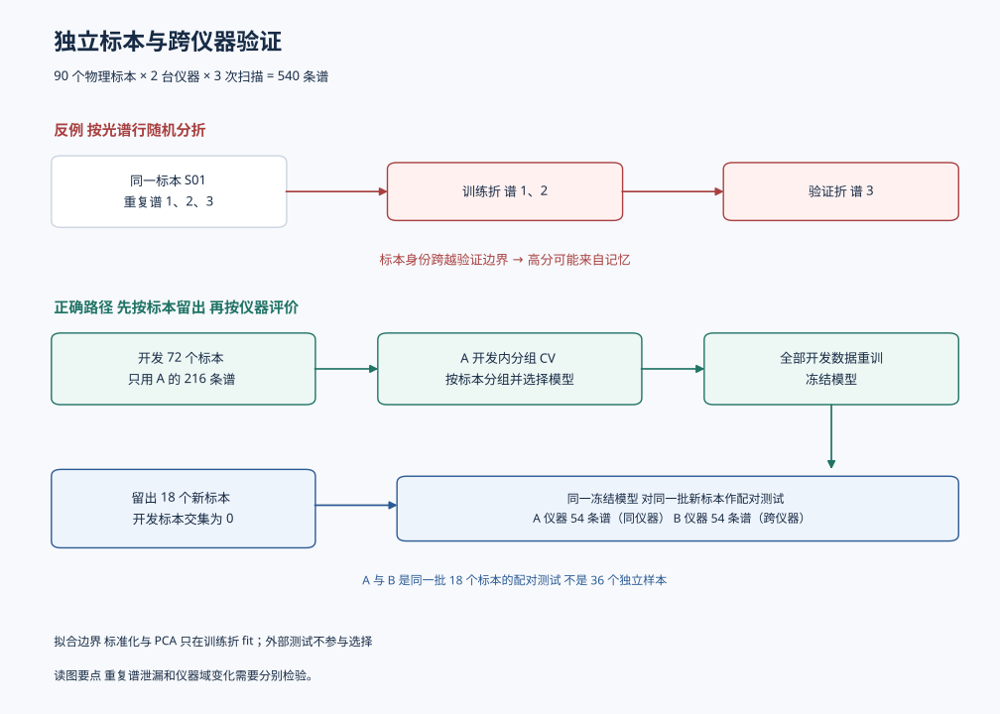
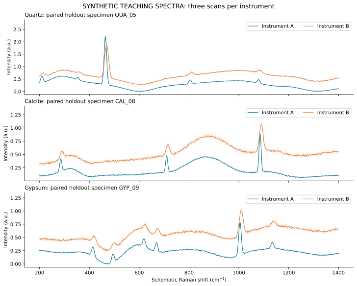
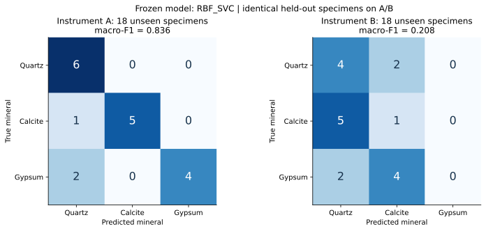
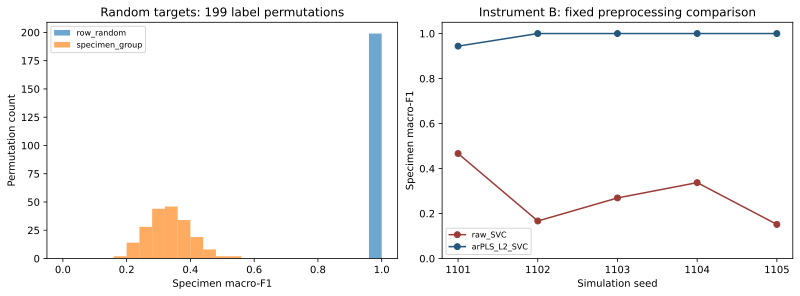
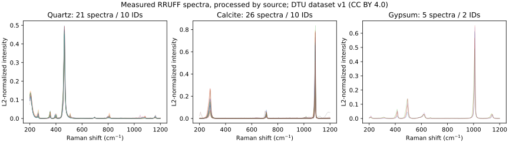
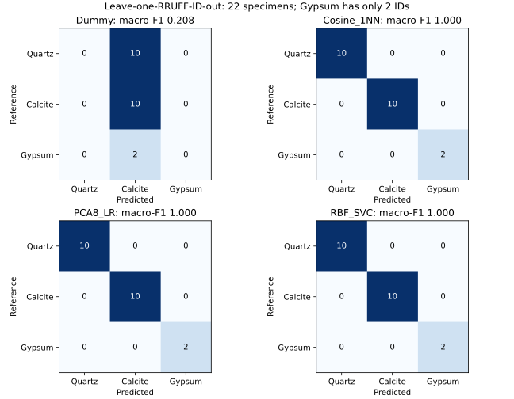

# 第4章 机器学习：化学计量学的非线性扩展

## 【章首导引】

机器学习进入分析化学，并没有改变测量问题的基本约束：训练样品仍须代表未来对象，参考值仍限制模型上限，仪器漂移仍会破坏预测，外部验证仍比训练拟合重要。改变的是可表达关系的范围。传统化学计量学擅长低秩、线性或近线性结构；机器学习可以表示非线性、变量交互和复杂边界，但也更容易利用批次、背景和偶然相关。本章不按算法流行度排列，而按“模型增加了什么表达能力、付出了什么验证代价”组织。


本章学习后，应能把化学任务写成输入、目标、损失与部署场景，解释主要模型的适用条件，设计无泄漏验证，并区分预测、概率与化学解释。第4.8节包含两个明确分开的案例：4.8.1–4.8.5为受控模拟，4.8.6为当前真实谱主案例。建议先运行真实谱分类，再用模拟理解泄漏和仪器变化。代码无需GPU，也不要求采购仪器。


| 阅读位置 | 要回答的问题 | 可检查的学习成果 |
|---|---|---|
| 4.1–4.2 | 预测谁，推广到哪里，怎样划分？ | 写出独立单位与训练、验证、测试边界 |
| 4.3–4.5 | 表达能力如何增加，代价是什么？ | 比较线性、核与集成模型，解释参数作用 |
| 4.6–4.7 | 分数、置信度和解释可信吗？ | 计算指标，说明校准与因果的限制 |
| 4.8–4.9 | 案例与近年前沿改变了什么判断？ | 复现分组验证、负对照和预处理对照 |

完整书目和每条文献用途见[年度第4章引文](#/resources/annual/2026-2027/references/README?id=ch04)。基础模型推导可结合 Hastie、Tibshirani 与 Friedman 的[统计学习教材](https://doi.org/10.1007/978-0-387-84858-7)阅读。

## 4.1 从统计模型到学习问题

### 4.1.1 任务、经验和性能

监督学习由输入 $X$、标签 $y$、模型族 $f_\theta$ 和损失函数 $L$ 组成，训练求解

$$\hat\theta=\arg\min_\theta \frac{1}{n}\sum_{i=1}^n L(y_i,f_\theta(x_i))+\Omega(\theta)$$

$\Omega$ 是复杂度惩罚。回归预测浓度或连续性质；分类预测类别；排序用于候选物优先级；异常检测判断样品是否偏离已知分布。无监督学习没有标签，主要寻找低维结构或聚类；半监督学习利用少量标签和大量未标记样品；自监督学习从数据本身构造预测任务，学习可迁移表示。

机器学习关注预测误差，经典统计更强调参数估计和生成假设，但二者并非对立。在线性回归中，正则化、交叉验证和概率误差模型同时属于两套传统。对分析化学而言，更实用的区分是：模型是否能解释测量机制，是否能量化不确定度，是否能在分布变化下保持性能。

### 4.1.2 基线模型是诊断工具

任何任务都应先建立层级基线。回归至少包括均值预测、单变量校准、MLR或PLS；分类至少包括多数类、PCA加线性判别或逻辑回归。复杂模型若没有稳定超过合理基线，说明新增表达能力并未转化为可重复信息。即使复杂模型更好，基线仍能帮助定位增益来源：超过PLS但不超过带RBF核的SVM，提示非线性重要；深度模型只在随机划分下更好而在跨批次测试中失效，提示它可能利用了混杂。

### 4.1.3 偏差、方差和学习曲线

模型误差可以从偏差、方差和不可约噪声理解。过于简单的模型在训练集和验证集上都表现较差，通常是高偏差；过于灵活的模型训练误差很小而验证误差明显增大，通常是高方差。分析化学的小样本、高维和强相关变量使高方差尤其常见。增加树深、核宽搜索范围或网络参数，能够降低训练误差，却不等于增加可推广的化学信息。

学习曲线把训练样本数与训练/验证误差联系起来。若两条曲线在较高误差处汇合，增加同分布样品的收益有限，应改进变量表示、测量质量或模型假设；若训练误差低而验证误差随样本增加持续下降，更多独立样品可能有效。这里的“样本数”必须按独立样品计数：把同一原样重复扫描十次不会产生十份新的化学覆盖。

还可绘制按化学空间覆盖而非样本数的学习曲线。先按浓度区间、结构骨架、批次或基质逐步扩大训练域，再观察外部域误差。若随机新增样品改善很小，而加入新基质后误差显著下降，说明瓶颈是覆盖而不是数量。样本获取策略因此应由失效区域决定，而不是只追求更大的 $n$。

## 4.2 数据划分与泄漏

### 4.2.1 化学相似性破坏独立同分布假定

相邻时间点、同一原样的重复谱、同一分子骨架的衍生物、同一组织切片的像素都高度相关。随机划分把近乎重复的样本放在训练和测试两侧，会把“记住相似对象”误认为“推广到新对象”。正确划分按最小独立单位分组：患者、批次、原始样品、结构骨架、采集日期或仪器。

如果预期部署在新实验室，应把实验室作为外部域；如果用于未来过程监测，应采用时间前向验证。模型评价回答的不是抽象的“准确率多少”，而是一个条件句：在怎样的样品、仪器和时间变化下，性能是多少。

### 4.2.2 预处理泄漏和选择泄漏

标准化均值、缺失插补、PCA载荷、特征选择阈值和数据增强参数都从数据中学习。它们必须在每个训练折内拟合。把全数据PCA后再交叉验证分类器，即使PCA没有使用标签，也会让验证折参与特征空间定义。反复查看测试集并调整模型，则把测试集变成了验证集。

嵌套交叉验证用内层选择预处理、模型和超参数，用外层估计整个选择流程的泛化误差。最终模型可在全部开发数据上按选定流程重训，但外层预测必须保存，不能用重训结果替代。

### 4.2.3 外推验证必须模拟真正的使用方向

随机交叉验证估计的是在当前样品总体内插值的能力。若模型将用于新的浓度范围、仪器、实验室或时间段，就要设计相应外推。浓度外推可将最高或最低区间留出；仪器外推可按整台仪器留出；时间外推应始终用过去训练、未来测试，而不能随机打乱。结构—性质模型则常按分子骨架或相似性聚类划分，避免同系列衍生物跨集合。

外推验证比随机验证更困难，也更接近方法的真实用途。两者应同时报告：前者在样本独立且划分合适时估计域内性能，后者检查指定外推场景。随机验证不构成理论上限。若二者差距很大，不能只选一个更高的数值发表；差距本身说明模型依赖了局部相关结构，需要扩大校准域、标准化仪器或建立域适应策略。

测试集也不应被神化。一个固定外部集若被团队反复使用，会逐渐参与模型设计，形成隐性过拟合。成熟项目应保留时间更新的监测集，并在部署后记录拒绝样品和错误类型，使验证从一次性分数变为持续性能证据。

### 4.2.4 从部署问题写出验证算法

“按组划分”中的组由未来用途决定。用于同一标本的新扫描和用于未知标本，是两个不同的预测问题。随机划分并非在所有任务中都错误；本章将“识别未见物理标本”作为目标，因此共享标本的逐谱划分不符合目标。若多个标本来自同一母岩或产地，验证新产地时还须按更高层级分组。[泄漏研究](https://doi.org/10.1016/j.patter.2023.100804)强调，应把数据依赖写入研究设计。

```text
先按部署单位保留最终测试集
对开发集的每个外层分组折：
    仅在外层训练部分构建内层分组折
    对每个候选预处理、模型和超参数：
        在内层训练折拟合完整Pipeline
        在内层验证折预测，按预定指标汇总
    用内层结果选定流程，在外层训练部分重新拟合
    保存外层验证预测，不用它反向修改本轮选择
汇总外层预测，评价整个选择流程
冻结流程后，使用开发数据重训并评估最终测试集
```

固定四个候选模型也会产生选择偏差：最高开发分数既参与选择，就不再是无偏的最终性能估计。第4.8节的模拟案例因此报告独立留出结果；真实案例固定并报告全部四个候选，不用这轮分数选模；需要比较大量参数时，采用上面的嵌套结构。[Cawley与Talbot](https://www.jmlr.org/papers/v11/cawley10a.html)讨论了选择准则本身的过拟合。

## 4.3 线性模型与正则化

### 4.3.1 Ridge、LASSO与Elastic Net

岭回归最小化

$$\|y-X\beta\|_2^2+\lambda\|\beta\|_2^2$$

它收缩相关变量的系数，适合大量共线波长。LASSO使用 $L_1$ 惩罚

$$\|y-X\beta\|_2^2+\lambda\|\beta\|_1$$

可使部分系数为零，形成稀疏模型；在一组高度相关变量中，它可能任意选择其中一个，所选波长未必稳定。Elastic Net组合 $L_1$ 与 $L_2$，常能保留相关变量组。系数稀疏不自动等于化学机制，需通过重采样稳定性和谱带归属验证。

逻辑回归把线性得分映射为概率：

$$P(y=1|x)=\frac{1}{1+\exp[-(\beta_0+x^T\beta)]}$$

概率阈值不应固定为0.5。筛查任务可能重视灵敏度，确证任务可能重视特异度，应根据假阳性和假阴性的代价选择阈值。

### 4.3.2 惩罚为何改变解

对已中心化的 $X$ 与 $y$，且截距不受惩罚，岭回归的一阶条件为

$$X^T(X\hat\beta-y)+\lambda\hat\beta=0,\qquad
\hat\beta=(X^TX+\lambda I)^{-1}X^Ty.$$

当 $\lambda>0$ 时，惩罚使小特征值方向的估计稳定。计算时应求解线性方程，不必显式计算逆。不同软件对损失是否除以样本数有不同约定，不能直接把不同实现的正则化数值等同。

Elastic Net的一种常用约定为

$$\frac{1}{2n}\|y-X\beta\|_2^2+\lambda\left[\alpha\|\beta\|_1+
\frac{1-\alpha}{2}\|\beta\|_2^2\right],\quad 0\leq\alpha\leq1.$$

$\alpha=1$ 对应LASSO，$\alpha=0$ 对应这一缩放约定下的岭回归。惩罚对单位敏感，应在训练折内缩放变量。相关谱带中的一个非零系数不能证明该单一波长具有独立化学作用。方法来源分别见 [Ridge](https://doi.org/10.1080/00401706.1970.10488634)、[LASSO](https://doi.org/10.1111/j.2517-6161.1996.tb02080.x) 与 [Elastic Net](https://doi.org/10.1111/j.1467-9868.2005.00503.x)。

## 4.4 核方法和高斯过程

### 4.4.1 支持向量机

支持向量分类寻找最大间隔边界，解由具有非零对偶系数的支持向量决定，其中也可包含间隔内或被误分类的样品。软间隔参数 $C$ 控制误分类惩罚；$C$ 大时拟合更紧，方差增大。核函数通过样品间相似度隐式表示非线性。RBF核

$$K(x_i,x_j)=\exp(-\gamma\|x_i-x_j\|^2)$$

中的 $\gamma$ 决定局部性。若变量未合理缩放，距离会被大尺度变量支配；若样品数很少，同时搜索很宽的 $C$ 和 $\gamma$ 网格，交叉验证容易选择偶然最优组合。

### 4.4.2 高斯过程回归

高斯过程把未知函数视为由核函数定义的函数分布：

$$f(x)\sim\mathcal{GP}(m(x),k(x,x'))$$

给定观测后，模型对新点给出预测均值和方差。其优势不是天然“更准确”，而是把局部数据密度、噪声和核假设转化为不确定度，适合小样本和后续贝叶斯优化。标准高斯过程计算随样本数约呈立方增长，且预测方差只反映模型内部假设；在分布外区域，若核或噪声模型不当，也会过度自信。

### 4.4.3 决策边界与预测方差的含义

二分类软间隔SVM可以写成

$$\min_{w,b,\xi}\ \frac12\|w\|^2+C\sum_i\xi_i,
\quad y_i(w^T\phi(x_i)+b)\geq1-\xi_i,\quad \xi_i\geq0.$$

这里 $y_i\in\{-1,+1\}$，$\phi$ 是核隐式对应的特征映射。SVM的决策函数是边界得分，不是自动校准的概率。$C$ 与 $\gamma$ 的效果还取决于缩放和样本分布，不能单凭参数大小判定模型优劣。[原始方法来源](https://doi.org/10.1007/BF00994018)。

零均值、观测噪声方差为 $\sigma_n^2$ 的高斯过程在新点 $x_*$ 的潜在函数后验为

$$\mu_*=k_*^T(K+\sigma_n^2I)^{-1}y,\qquad
v_*=k(x_*,x_*)-k_*^T(K+\sigma_n^2I)^{-1}k_*.$$

预测新的含噪观测时，还须加上观测噪声方差。这个表达式依赖所选核与噪声假设，不包含所有基质变化、仪器故障或未知化学组分。[Rasmussen与Williams教材](https://gaussianprocess.org/gpml/)提供完整推导。

## 4.5 树模型与集成学习

决策树通过特征阈值递归划分空间，可以表示非线性交互，但单树方差高。随机森林对自助样本和随机特征子集训练多棵树后平均，降低方差，适合中等规模表格数据。梯度提升逐步拟合当前残差，常有更高精度，但对学习率、树深和迭代数敏感。

对连续光谱，树模型把相邻波长视为独立候选阈值，可能忽略峰形连续性，也可能在许多高度相关波长间分散重要性。基于纯度下降的特征重要性偏向可分裂点多的变量；置换重要性在相关变量中又会低估单个变量，因为其信息可被邻近波长替代。解释应以波段或结构单元为单位，并通过干预或消融验证。

梯度提升模型可理解为在函数空间逐步纠正残差。第 $m$ 棵树拟合前 $m-1$ 棵树尚未解释的部分，学习率控制每一步修正幅度。较小学习率配合更多弱树通常更稳健，但必须用早停或交叉验证决定迭代次数。树深决定交互阶数：树桩主要表示加性效应，深树能够表示高阶交互，同时也更容易利用稀疏批次特征。

树模型特别适合样品元数据、理化指标和离散工艺条件构成的表格。对高分辨连续谱，可先按有意义波段汇总、用PCA/PLS得分表示，或采用能利用局部结构的一维卷积。算法与数据表示应匹配；把每个波长直接交给提升树并不能自动获得峰形知识。

### 4.5.1 选择模型时同时比较假设与验证成本

| 方法 | 学习的关系或先验 | 化学数据中的常见用途 | 主要检查点 |
|---|---|---|---|
| PLS、Ridge | 低维潜变量或收缩的线性关系 | 共线光谱与小样本定量 | 潜变量数、惩罚强度、线性是否足够 |
| LASSO、Elastic Net | 稀疏或分组收缩 | 波段筛选、描述符回归 | 相关变量选择是否稳定 |
| SVM、SVR | 由核定义的平滑或局部边界 | 中小规模非线性任务 | 距离缩放、核参数和分组验证 |
| 高斯过程 | 核协方差与显式噪声模型 | 小样本回归、不确定度 | 核假设、计算成本和覆盖检验 |
| 随机森林 | 多棵随机树平均 | 理化指标与元数据表格 | 树相关性、组内重复、重要性偏差 |
| 梯度提升 | 逐步拟合损失的负梯度 | 非线性和变量交互 | 学习率、早停集和超参数选择 |

随机森林的袋外评价只把某一行排除在单棵树训练外，不能保证该行的同标本重复谱也被排除。因此有重复扫描时，袋外分数不能替代按标本的验证。梯度提升的“拟合残差”是平方损失下的直观说法，一般损失对应负梯度。[随机森林](https://doi.org/10.1023/A:1010933404324)和[梯度提升](https://doi.org/10.1214/aos/1013203451)原始论文给出方法定义。

## 4.6 评价指标和概率校准

### 4.6.1 回归

MAE对大误差的惩罚线性，RMSE对大误差更敏感；二者应使用原始分析单位报告。相对误差在接近零时不稳定。$R^2$ 受目标范围影响，不能取代绝对误差。预测区间覆盖率和区间宽度应同时报告：过宽区间虽覆盖率高，却没有决策价值。

残差应按浓度、批次、仪器和时间分层。总体RMSE相同的两个模型，可能一个在低浓度区严重偏差，另一个误差均匀；用于检出限附近时，两者价值完全不同。

### 4.6.2 分类

准确率适合类别平衡且错误代价相近的任务。灵敏度 $TP/(TP+FN)$ 描述检出阳性的能力，特异度 $TN/(TN+FP)$ 描述排除阴性的能力。ROC-AUC总结不同阈值下的排序，但类别极不平衡时PR-AUC更能反映阳性预测质量。

分类器输出0.9不一定意味着90%的样品正确。可靠性图和Brier分数用于评估概率校准。温度缩放、Platt缩放和保序回归可以校准概率，但校准器同样必须在独立验证数据上拟合。

### 4.6.3 不确定度的来源与覆盖检验

预测不确定度至少包括两类。偶然不确定度来自测量噪声和样品本身不可分辨的变化，即使有无限数据也不能完全消除；认知不确定度来自模型参数和训练域覆盖不足，可通过增加有信息的样品降低。同条件重复测量主要估计测量重复性这一部分，不能代表全部偶然不确定度；模型集成、贝叶斯模型或重采样可近似后者。只报告神经网络softmax概率，通常不能区分两者。

回归预测区间应在独立数据上检查经验覆盖率。例如标称95%的区间若只覆盖80%的外部样品，说明不确定度被低估；若覆盖接近100%但区间极宽，模型对决策帮助有限。除覆盖率外，还应按浓度、基质和仪器分层检查区间宽度。共形预测可在较弱分布假设下构造有限样本覆盖保证，但其保证依赖校准样品与未来样品可交换；遇到明显分布漂移时仍会失效。

不确定度不是装饰性误差条，而应进入决策。筛查系统可规定：只有当阳性概率和适用域判据同时达到阈值时自动报告，否则转入复测；定量系统可在区间跨越法规限值时触发确证方法。这样，模型能够承认“不知道”，而不是被迫对每个样品给出确定答案。

### 4.6.4 适用域与分布外检测

适用域描述模型被哪些样品支持。在线性潜变量模型中，可同时考察得分空间的Hotelling $T^2$ 和重构Q残差：前者表示样品在已建模方向上是否极端，后者表示是否包含未被模型表示的新结构。二者互补；一个样品可以得分不极端却有很大残差，说明它具有新的谱形。

现代分布外检测可使用特征空间距离、密度估计、深度集成分歧或能量分数，但没有一种指标对所有新域可靠。距离还受缩放和高维集中影响。适用域阈值应由保留数据和已知挑战样品确定，并报告拒绝率与拒绝后错误率。一个高拒绝率系统可能很安全，却几乎不能处理真实样品；因此覆盖范围与准确性必须共同评价。

### 4.6.5 用可复算的公式区分三种评价

对 $n$ 个独立测试样品，回归误差为

$$\mathrm{MAE}=\frac1n\sum_i|y_i-\hat y_i|,\quad
\mathrm{RMSE}=\sqrt{\frac1n\sum_i(y_i-\hat y_i)^2},\quad
R^2=1-\frac{\sum_i(y_i-\hat y_i)^2}{\sum_i(y_i-\bar y)^2}.$$

当所有参考值相同时，$R^2$ 分母为零，不能赋予通常的解释。$R^2<0$ 表示在该测试集上平方误差大于用其参考值均值作常数预测的误差，并不意味着计算失败。

对 $K$ 个类别，$F1_k=2TP_k/(2TP_k+FP_k+FN_k)$，宏平均F1为各类别F1的算术平均，平衡准确率为各类别召回率的平均。两者不可混用。三类均衡数据上始终预测同一类，平衡准确率为 $1/3$，宏平均F1仅为 $1/6$。

二分类Brier分数为 $n^{-1}\sum_i(p_i-y_i)^2$。它同时受校准、区分能力和数据不确定性影响，不是纯粹的校准误差。可靠性图还要显示每个概率区间的样本量，避免用少数样品的比例判断可靠性。[Guo等](https://proceedings.mlr.press/v70/guo17a.html)与[官方实现说明](https://scikit-learn.org/stable/modules/calibration.html)可配合阅读。

概率校准和分类阈值选择也属于模型开发。配套练习把2400个模拟独立对象分为拟合1440、校准480、阈值选择240、最终测试240四部分。假阴性代价增加后，阈值可以下降；测试标签不参与选择。实际例子中校准后Brier略高于校准前，应保留这一结果，不能宣称校准必然改善所有数据。

共形预测的通常保证是可交换条件下的边际覆盖，不保证每一种矿物、每台仪器或每个浓度都有相同覆盖率，也不自动跨越分布漂移。[共形预测导论](https://doi.org/10.1561/2200000101)解释这些条件。

## 4.7 可解释性：贡献不等于因果

线性系数、树重要性、SHAP和显著性图都回答“在当前模型中，哪些输入改变了预测”，而不是“哪些变量在化学上导致了结果”。当批次与类别相关时，解释方法会忠实指出批次特征，因为模型确实依赖它。注意力权重也不是机制证明。

[SHAP原始论文](https://proceedings.neurips.cc/paper_files/paper/2017/hash/8a20a8621978632d76c43dfd28b67767-Abstract.html)提供模型归因框架。可信解释至少经过三层检查：统计稳定性，即不同重采样和随机种子下解释是否一致；化学合理性，即重要波段是否对应可能的振动、吸收或反应过程；干预验证，即遮蔽、置换或独立改变该因素时预测是否按预期变化。若解释只在训练数据上成立，不应将其写成机理。

### 4.7.1 从模型解释走向反事实检验

反事实问题是：在保持其他条件尽可能不变时，只改变某一化学因素，预测是否作出合理响应。对光谱分类，可在相同仪器、容器和批次下制备一系列只改变目标组分浓度的样品；对成像模型，可替换背景而保留目标区域；对分子模型，可构造成对结构变化。若预测随非目标背景改变而大幅波动，就暴露了捷径特征。

数学遮蔽也应尊重信号结构。把单个波长设为零会产生训练数据中从未出现的尖锐缺口，得到的归因可能只是对伪影的响应。更合理的方法是遮蔽完整谱带、用局部基线或条件生成模型填补，并与实验干预比较。解释方法若不能预测真实干预结果，只能作为模型调试线索。

因果判断还需要区分中介和混杂。例如样品粒径既影响散射又与生产批次相关；模型依赖散射可能是利用真实粒径信息，也可能是借粒径识别批次。是否应去除散射取决于任务：若预测粒径相关性质，它可能是有效信号；若识别化学组成，它可能是干扰。所谓“去批次”不是纯数学选择，而是对目标因果关系的声明。

## 4.8 贯穿案例：跨仪器拉曼矿物识别

### 4.8.1 任务、数据和结论边界

识别石英、方解石与石膏，回答“能否推广到未见物理标本，以及同一批标本换仪器后怎样变化”。全部光谱由代码生成，含示意峰、标本稳定背景、技术重复噪声和仪器扰动。峰位参数是简化教学设定，没有实测谱图或权威峰归属的含义。这里讨论闭集三分类，不能推断混合矿物、未知类别或检出限。

| 数据部分 | 独立标本 | 仪器与扫描数 | 用途 |
|---|---:|---|---|
| 开发集 | 72，每类24 | A，216条谱 | 4折分组比较与选模 |
| 开发标本的B谱 | 同一72个 | B，216条谱 | 保留但完全不用于拟合、选择或评价 |
| 留出集 | 18，每类6 | A与B各54条谱 | 同一批未见标本的配对测试 |

合计90个标本、540条谱，每条有601个变量。每个标本在每台仪器上测3次。A/B测试集合计仍只有18个独立标本。若实际实验存在母岩、产地或采集批次依赖，还应考虑更高层分组。





图4-1　每幅小图取一个留出标本，展示A、B各3条模拟谱；它是数据结构的示意，不代表三类矿物的全部变化。横轴为模拟拉曼位移，纵轴为任意单位强度。观察同一标本的重复谱相似性，以及换仪器后峰形和背景的共同变化。图由 `exercise.py` 生成，示意峰不用于权威峰归属。

### 4.8.2 固定基线与两层验证

比较多数类、标准化加1NN、标准化加8维PCA与逻辑回归、标准化加RBF-SVC。参数固定，所有跨样本学习的转换都放入Pipeline。使用开发集按标本分组的折外宏平均F1选模，同分时按上述次序选择。随后在A开发集重训，冻结后测试A/B留出谱。3次扫描的预测多数投票得到标本类别，同票按编码顺序处理。

| 模型 | 逐谱随机划分，标本宏F1 | 按标本分组，标本宏F1 |
|---|---:|---:|
| 多数类 | 0.1667 | 0.1667 |
| 1NN | 0.9861 | 0.5537 |
| PCA与逻辑回归 | 0.8472 | 0.7352 |
| RBF-SVC | 1.0000 | 0.8473 |

表中是固定种子2026的实际计算结果。逐谱随机列允许同一标本跨越训练与验证，其中3次折外预测可能来自不同模型实例，投票不会修复泄漏。两列差异还涉及训练标本覆盖，不能把分数差完全解释为纯粹的泄漏效应量。

按开发规则选出的RBF-SVC在A留出标本上的宏F1为0.8364，在同一批标本的B谱上为0.2081。该下降反映本模拟所设定的复合扰动，不代表真实仪器的普遍性能。仪器变化包含峰位偏移、展宽、响应斜率、背景与噪声，不能仅凭这一次比较判定其中哪一项导致全部下降。



图4-2　行是真实类别，列是预测类别，每格计数单位是物理标本。每个矩阵合计18，A、B使用同一批标本；对角线为正确预测，非对角线显示具体误判方向。图来自冻结模型的 `holdout_sample_predictions.csv`，不能把两个矩阵相加当作36个独立标本。

### 4.8.3 随机标签负对照

对72个开发标本随机分配均衡的三类标签，同一标本的重复谱继承同一个标签。1NN在199次置换中，逐谱随机划分的宏F1均值为0.9818，而按标本分组为0.3335。后者的2.5%–97.5%分位数约为0.2221–0.4583。它们描述随机标签模拟的分布，不是矿物识别性能的置信区间。

这个对照表明：重复谱共享的身份信息可以让模型“预测”没有化学意义的标签。它不证明正任务完全没有化学信号，也不要求每次置换恰好等于1/3。

### 4.8.4 预处理能否改善指定扰动

扩展练习固定使用五个模拟种子1101–1105，完整报告所有种子。比较原始变量标准化SVC与“逐谱arPLS基线扣除、L2归一化、SVC”的完整流程，并保留多数类基线。arPLS参数固定为λ=100000、最多30轮、收敛阈值0.001，依据 [Baek等的算法](https://doi.org/10.1039/C4AN01061B)实现。它只利用每条谱自身，不使用测试标签或其他测试谱；后续模型仍在训练折内拟合。

| 五个种子的结果 | 原始变量标准化SVC | arPLS与归一化SVC |
|---|---:|---:|
| 开发分组宏F1均值 | 0.8916 | 0.9972 |
| A留出宏F1均值 | 0.9128 | 1.0000 |
| B留出宏F1均值 | 0.2783 | 0.9888 |
| B留出宏F1范围 | 0.1515–0.4667 | 0.9441–1.0000 |

五次均由开发分组结果选出处理后流程。A/B留出结果只用于冻结后的比较，不用于选择。该对照同时改变基线扣除和归一化，应解释为整个处理流程的效果，不能将全部增益归给其中一步。

这组高分与模拟中三种矿物的峰形容易区分、宽背景可被滤除有关。它说明合理处理可能比增加模型复杂度更有效；它没有验证真实仪器迁移，也没有做波数轴校准、混合矿物识别或未知类别拒绝。原始种子2026在此前已被查看，扩展是明确披露的教学敏感性分析，不宣称前瞻注册研究。



图4-3　左图汇总199次标本级标签置换，纵轴是次数；右图逐一列出五个种子的B留出宏F1。图由 `extensions.py` 生成。右侧连接线仅帮助跟踪固定流程，种子不是时间或有序物理变量，不能解释为随种子增加而改善的趋势。

逐谱arPLS先估计缓慢变化的背景并相减，随后L2归一化将每条谱除以自身欧氏范数，减少整体强度尺度的影响。这两步都不需要其他标本的数据，但也可能去掉真实测量中有用的宽峰或绝对强度信息。原始流程还包含跨标本的变量标准化，因此本例比较的是两个完整Pipeline，未分别隔离各步骤的效应，也不能用高分证明每个操作都适用于实际矿物谱。

### 4.8.5 交互查看划分与实际计算结果

切换划分方式和验证折，检查同一标本的3次扫描是否出现在两侧；再比较模型、仪器和处理流程。页面展示由Python输出生成的预计算结果，浏览器只重新汇总与绘图，不实时训练SVC。

<section class="ch04-lab"></section>

<a href="assets/interactive/ch04.html" target="_blank" rel="noopener" data-no-router>在独立页面打开交互模块</a>

### 4.8.6 真实主案例：RRUFF实测谱的按标本验证

本案例实际使用了52条实测拉曼谱。来源为Li、Schmidt、Alstrøm在DTU发布的[论文配套存档v1](https://doi.org/10.11583/DTU.20222331.v1)，许可CC BY 4.0。它是经过来源方处理的历史RRUFF衍生数据，不是本组亲自采集的原始信号，也不是当前RRUFF完整导出。原始归属、筛选及格式转换见[真实谱说明](#/code/ch04_exercises/rruff_real/README)和[数据归属](#/code/ch04_exercises/rruff_real/ATTRIBUTION)。

| 矿物 | 实测谱数 | RRUFF标本ID数 |
|---|---:|---:|
| 石英 Quartz | 21 | 10 |
| 方解石 Calcite | 26 | 10 |
| 石膏 Gypsum | 5 | 2 |

本次保留来源存档中这三类的全部记录，不按预测效果筛数据。每条谱保留原坐标和强度、标本ID、来源文件、激光波长与数值校验和。所有谱覆盖200–1200 cm⁻¹，统一插值为501个变量并逐谱L2归一化；插值不构成新增观察。

目标改为“识别数据库中未见标本”。按RRUFF ID留一，共22折，每折留出一个ID的所有谱。固定候选为多数类Dummy、余弦1近邻、PCA(8)＋逻辑回归、RBF-SVC。学习型标准化、PCA和分类器均在训练折内拟合。汇总所有折外预测后按标本投票，再计算指标；不能对只有单类的验证折分别算宏F1然后取平均。具体参数见代码中的固定方案。

| 固定候选 | 标本宏F1 | 标本平衡准确率 | 正确标本数 |
|---|---:|---:|---:|
| Dummy | 0.2083 | 0.3333 | 10/22 |
| Cosine_1NN | 1.0000 | 1.0000 | 22/22 |
| PCA8_LR | 1.0000 | 1.0000 | 22/22 |
| RBF_SVC | 1.0000 | 1.0000 | 22/22 |



图4-4　52条来源方已处理的实测谱，在固定区间插值并L2归一化展示。来源：Li等，DTU存档v1，CC BY 4.0；本组筛选三类并转换格式。图中每条曲线是一条存档谱，同一ID下多条谱并非独立标本。



图4-5　22个标本的折外投票结果。三个非平凡模型在这个子集上均正确识别全部标本，未据此选出“最佳模型”。这只能说明当前三类已处理谱容易区分，无法证明复杂模型优于简单谱匹配。

**解释边界：** 石膏只有2个标本，尚未设置独立外部测试集。RRUFF ID不能排除共同母岩或产地依赖。激光波长不是仪器ID，未确认配对双仪器数据，不能宣称跨仪器迁移；来源方已完成的处理也不能当作本组验证arPLS的证据。以后若依据本轮结果调参，应使用嵌套分组验证或新增留出标本。旧模拟中的A/B性能下降及处理增益均不转写为实测结论。

<a href="assets/interactive/ch04-real.html" target="_blank" rel="noopener" data-no-router>打开真实谱交互页：查看来源、谱形与折外预测</a>

安装已有锁定依赖后，在仓库根目录运行：

```bash
python code/ch04_exercises/rruff_real/reproduce.py
```

仓库已附带数值子集，可离线重跑训练与核验；`--redownload`可重新获取固定来源存档。此处“亲自跑实验”指组员在自己的电脑执行程序、核对数据与结果并解释限制，不等于亲自在仪器上采谱。

## 4.9 年度前沿更新与证据等级

### 更新一 REFORMS研究与报告规范 2024

[Kapoor等，Science Advances](https://doi.org/10.1126/sciadv.adk3452)提出32项问题及配套建议，覆盖科学机器学习的设计、实施与报告。对本章的用途是把独立单位、数据隔离、选择过程和外部有效性变成可审查事项。它是方法学共识，不是新分类器，也不提供拉曼识别性能保证。应用到本案例后，必须保留分组审计、选模规则与模拟边界。

### 更新二 拉曼验证策略的直接比较 2025

[Lilek等，Journal of Raman Spectroscopy](https://doi.org/10.1002/jrs.6842)在四个生物拉曼数据集上比较多种验证策略。出版社摘要报告，按组留出给出更低的性能估计，部分数据中的分层K折与嵌套验证结果接近。它支持本章把验证设计当作研究问题。该结果受对象、分组和比较流程限制，不能推成“任何任务都不需要嵌套验证”，也不是矿物跨仪器实验。公开代码可查，部分数据须向作者申请，不能默认全部数据可直接下载。

### 更新三 表格基础模型与小样本评价 2025

[Hollmann等，Nature](https://doi.org/10.1038/s41586-024-08328-6)研究预训练的表格基础模型TabPFN。它提供了与逐任务拟合线性、核或树模型不同的候选方法。对分析化学的启发是：小样本任务的候选模型范围在扩大，但预训练本身不能修复样本重复、目标泄漏或仪器漂移。本练习没有运行TabPFN，也不将其通用表格基准结果当作拉曼分类证据。

三张卡均有原始来源，分别属于方法学共识、谱学验证原始研究和模型方法原始研究。年度检索与书目核对日期为2026-10-23，归档保留方法经典文献，避免仅以年份判断证据价值。

## 【本章小结】

机器学习扩展了化学计量学的函数表达能力，却没有取消其测量学前提。正确的数据划分、透明基线、嵌套选择、外部验证和失效分析，比模型名称更能决定结果。线性模型适合解释和小样本，核方法表示平滑非线性，树模型擅长表格交互，高斯过程提供模型内不确定度；它们的选择应由数据结构和部署条件决定。可解释方法只能描述模型依赖，化学机制仍需实验干预。

## 【思考题与习题】

### 基础题（60%）

1. 为什么在全数据上标准化后再交叉验证属于信息泄漏？
2. 比较Ridge、LASSO和Elastic Net在高度相关光谱变量上的行为。
3. 解释SVM中 $C$ 和RBF核 $\gamma$ 的作用。
4. 为什么高AUC不保证输出概率可靠？

### 进阶题（30%）

5. 为同一样品多次测量的数据写出嵌套分组交叉验证伪代码。
6. 某随机森林的重要波长不稳定，但相邻波段总体稳定。如何解释并改进重要性分析？
7. 比较PLS与神经网络在小样本近红外定量中的偏差—方差和维护成本。

### 开放题（10%）

8. 设计一项反事实实验，验证分类器依赖的是目标化学差异而不是样品容器或背景。

## 【代码实践】

可先阅读[跨平台运行与故障说明](#/code/ch04_exercises/raman/README)。安装依赖后，运行 `python code/ch04_exercises/raman/reproduce.py` 可顺序完成以下全部步骤并记录日志；下面保留分步命令供学习。所有命令从仓库根目录执行。Python 3.12，锁定依赖见 `code/ch04_exercises/raman/requirements.txt`。

```bash
python -m pip install -r code/ch04_exercises/raman/requirements.txt
python code/ch04_exercises/raman/exercise.py
python code/ch04_exercises/raman/extensions.py
python code/ch04_exercises/03_probability_calibration.py --output code/ch04_exercises/raman/outputs/calibration.json
python code/ch04_exercises/raman/export_interactive.py
python code/ch04_exercises/raman/verify.py
```

第一次运行生成完整光谱CSV/NPZ和图表。版本库保存小型指标、预测、审计与SVG，避免把可生成的大矩阵当成原始实验数据。案例的[复现说明](#/code/ch04_exercises/raman/README)给出输入输出、参数和常见问题。

- `01_group_split_leakage.py`：最小随机标签与重复谱示例。
- `02_nested_model_selection.py`：PLS、Ridge、SVR与随机森林，内外层均按标本分组；外层评价整个选择流程。
- `03_probability_calibration.py`：拟合、校准、阈值选择和最终测试四部分隔离。
- `04_explanation_stability.py`：系数重采样与整段变量置换，展示相关变量的解释稳定性；没有实现SHAP。
- `raman/exercise.py` 与 `extensions.py`：本章拉曼主案例、199次负对照与五个种子的处理对照。

## 年度课程资源、传承题与更新引文

本章的稳定教材内容与逐年更新的教学资源分开维护。维护组须在年度归档中同步补入课件链接、可传承的题目和有来源链接的前沿引文。

- [本学年课程 PPT（PDF）](#/resources/annual/2026-2027/ppt/README?id=ch04)
- [留给下一届的本章传承题](#/resources/annual/2026-2027/questions/README?id=ch04)
- [G04学生汇报、讲稿及要求对照](#/resources/annual/2026-2027/student-reports/ch04/README)（学生稿，未经教师审核）

### 本章首批可点击引文

- Wu, Z. *et al.* [MoleculeNet: a benchmark for molecular machine learning](https://doi.org/10.1039/C7SC02664A). *Chemical Science* **9**, 513–530 (2018).
- [查看本章 2026–2027 学年完整引文与后续更新](#/resources/annual/2026-2027/references/README?id=ch04)

---

## 本章共建记录与致谢

| 学年 | 贡献者 | 工作内容 | 关联PR |
|---|---|---|---|
| 待本学年维护组补充 | — | — | — |
